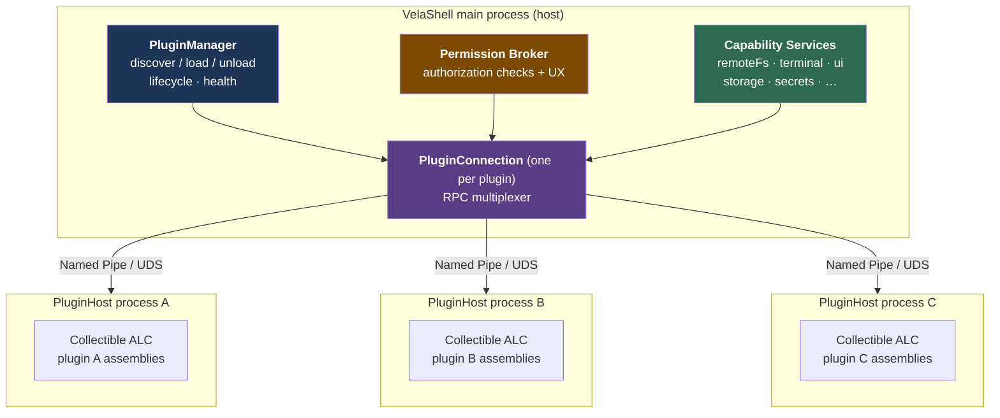

# 02 · Overall Architecture

> **Implementation note (2026-08)**: The process model has been implemented in a "dual-mode" form. The manifest's `hostMode` selects either in-process execution (the default, with a collectible ALC) or an isolated process (the D1/D2/D3 path in this document; see the note in 05 for protocol deviations). The project split differs slightly from §2: `PluginProtocol` and `PluginSdk` are combined (`plugin-sdk/VelaShell.PluginSdk`, with RPC contracts in its `Rpc/` namespace), `PluginHost` is located at `src/VelaShell.PluginHost`, and the dependency discipline is unchanged (PluginHost references only the SDK and no main-application project). See dev-guide.md for current details.

## 1. Process Model



> **In-process mode** (the current default) has no pipe in the middle: `PluginManager` opens a
> collectible ALC inside the host process, capability calls are ordinary method calls, and the
> plugin's UI joins the docking workspace directly. The diagram above shows the **isolated-process**
> path (D1/D2/D3). Both modes share one set of SDK contracts and the plugin source is identical.

Core decisions (expanded in the corresponding documents):

| # | Decision | Rationale | See |
| --- | --- | --- | --- |
| D1 | **One PluginHost process per plugin by default** | Isolation between plugins (G2); a single plugin crash or hang affects only that plugin; uninstallation means ending the process, with no risk of leftover assemblies after unloading | 04 |
| D2 | Use a **collectible AssemblyLoadContext** inside PluginHost to load plugin assemblies | Hot reload during development (replace assemblies without restarting the process); completely decouples dependency-version conflicts between the host and plugins | 04 |
| D3 | Use **Named Pipe (Windows)/Unix Domain Socket (macOS/Linux) + JSON-RPC 2.0 (StreamJsonRpc + MessagePack encoding)** for IPC | Fully managed, cross-platform, supports bidirectional calls and notifications, and has mature cancellation/progress semantics; avoids gRPC code generation and HTTP/2 complexity | 05 |
| D4 | Send large data (file contents, image frames) through a **side channel**: chunked streaming RPC + shared-memory (MemoryMappedFile) image surfaces | Avoids blocking the control channel with large payloads and avoids base64 expansion | 05 / 08 |
| D5 | **All capability calls go through the main-process Broker**. Plugin processes hold no credentials (SSH keys, passwords, and API keys never leave the main process) | A single enforcement point for permissions; minimizes the credential exposure surface | 06 / 12 |
| D6 | **The host renders plugin UI**: declarative contribution points + VelaUI remote interface tree, with zero Avalonia dependency in the plugin process | The only UI solution under process isolation that does not compromise consistency; themes, i18n, and DPI are unified naturally | 08 |
| D7 | Lazy activation: at startup, read manifests only and register placeholder contribution points; start the process only when an **activation event** matches | Startup performance (G9); a model validated by VSCode | 03 |
| D8 | Version strategy: **apiLevel (integer) + SDK semver**, with the manifest declaring the compatible `engines` range | Provides a clear promise of backward compatibility within a level and permitted breaking changes across levels | 03 / 09 |
| D9 | **Reuse the host's existing connections** for remote capabilities (add a permission-constrained proxy on top of the neutral `Core.Ssh` interface); plugins do not directly touch Tmds.Ssh | Avoids repeated authentication; library types do not leak (preserves the existing architectural discipline) | 07 |

## 2. Component and Project Layout

New projects (following the existing centralized package management in `Directory.Packages.props` and `net11.0`):

```text
src/VelaShell.PluginProtocol/    -> IPC contracts: RPC interfaces, DTOs, error codes, apiLevel constants.
                                    No Avalonia dependency, no Tmds.Ssh dependency; referenced by the host and SDK.
src/VelaShell.PluginSdk/         -> NuGet package referenced by plugin developers: IPlugin entry-point convention,
                                    capability proxies (RemoteFs/Terminal/Ui/Storage/...),
                                    VelaUI virtual-tree builder, and test doubles. Depends on PluginProtocol.
src/VelaShell.PluginHost/        -> Standalone executable (distributed with the main application): establishes IPC,
                                    loads plugins with collectible ALC, bridges RPC to plugin instances, heartbeat and self-healing.
tools/vela-plugin/               -> dotnet tool: pack / sign / validate / install.
templates/velaplugin/            -> dotnet new template.
samples/plugins/                 -> Official examples: image-viewer / mp3-player / auto-runner.
```

On the main-application side (no new top-level project; placed according to the existing dependency direction):

```text
VelaShell.Core/Plugins/            -> Domain models: PluginDescriptor, PermissionId,
                                      PluginState, and contribution-point models (pure data, testable).
VelaShell.Infrastructure/Plugins/  -> PluginManager (discovery/installation/loading/unloading), process management,
                                      PluginConnection (RPC endpoint), PermissionBroker,
                                      PermissionStore, and capability-service implementations (bridges to Core.Ssh, etc.).
VelaShell.Presentation/Plugins/    -> Plugin-management page VM, authorization-dialog VM, contribution-point to UI mapping,
                                      and VelaUI rendering coordination.
VelaShell/(App)                    -> Plugin-management view, authorization-dialog view, VelaUI renderer controls,
                                      and contribution-point mounting (command palette/menu/status bar/sidebar/VelaDock document).
```

Dependency direction (preserving the discipline in architecture.md):

```text
Infrastructure/Plugins -> Core/Plugins, Core.Ssh, PluginProtocol
Presentation/Plugins   -> Core/Plugins
PluginHost             -> PluginProtocol (no dependency on any VelaShell.* main-application project)
PluginSdk              -> PluginProtocol
```

`PluginProtocol` is the "narrow waist" at the isolation boundary. It is the only assembly shared by the host and plugin worlds, so it must have zero heavyweight dependencies and follow strict apiLevel compatibility rules.

## 3. Full Path of a Typical Call

Using S1 (the image viewer reading a remote file) as an example:

```text
Plugin code: await vela.RemoteFs.ReadAsync(sessionId, "/var/www/a.png")
  → SDK proxy encodes the call as JSON-RPC request "remoteFs/read"
  → PluginHost sends it to the main process through the pipe
  → PluginConnection receives it, looks up the routing table → RemoteFsCapabilityService
  → PermissionBroker.Demand(pluginId, "remote.files", scope: sessionId)
      · Authorized → allow
      · Not authorized → show an authorization dialog on the UI thread and await the user's decision; if denied, throw PermissionDeniedException (returned to the plugin through RPC)
  → RemoteFsCapabilityService reads the file through Core.Ssh's ISftpClient
  → Content is returned to the plugin as a chunked stream (see 05 §6); progress/cancellation are available throughout
```

Key properties: permission checks are completed in the **main process**, credentials never leave the main process, and data streams do not pass through the UI thread.

## 4. Lifecycle State Machine (Overview)

```text
 Discovered ──manifest validation passes──▶ Installed (contribution-point placeholders registered)
    Installed ──activation event matches──▶ Starting (start PluginHost, handshake)
    Starting ──Activate() returns──▶ Active
    Active ──idle reclamation/user disable/uninstall──▶ Deactivating (call Deactivate, with timeout)
    Deactivating ──process exits──▶ Installed / Removed
    Active/Starting ──crash/heartbeat timeout──▶ Crashed ──backoff restart (≤3 times)──▶ Starting
                                        └─threshold exceeded──▶ Faulted (UI highlighted red, awaiting user action)
```

See [03-plugin-model.md](03-plugin-model.md) and [04-plugin-host.md](04-plugin-host.md) for the complete definitions.

## 5. Data and Directory Layout (on the User's Machine)

```text
~/.velashell/plugins/
  installed/<pluginId>/<version>/     -> unpacked plugin (used read-only)
  data/<pluginId>/                    -> plugin-private data directory (root of the storage capability)
  permissions.json                    -> persisted authorization decisions (see 06)
  registry-cache/                     -> plugin-source index cache (see 10)

~/.velashell/logs/plugins/
  <pluginId>.log / <pluginId>.log.1   -> one log per plugin (rotated once at 1 MB, see §6)
```

(Note 2026-10-24: the blueprint originally drew the logs under `~/.velashell/plugins/logs/<pluginId>/`; they actually live in the host's
log directory, in a `plugins/` subdirectory of the same `logs/` that holds the host's own `velashell-*.log`.)

## 6. Cross-Cutting Concerns

- **Logging** (landed 2026-10-24): one file per plugin, `~/.velashell/logs/plugins/<pluginId>.log`, rotated at 1 MB into `<pluginId>.log.1`
  with only that one old copy kept (before 2026-10-31 it was `<pluginId>.1.log`, which collided with the current log of a plugin whose id is `<pluginId>.1`); one timestamp per line, with the continuation lines of exception stack traces kept intact. Every source is
  on the host side: what the plugin writes through `context.Log` (`IPluginLogger`; called directly in-process, relayed over RPC from isolated
  processes), the isolated process's stdout / stderr, and the activation / activation-failure / crash entries the host records for the plugin;
  the copy in the host log stays as before. A plugin's `Trace.WriteLine` does not reach this file (in an isolated process it is not collected anywhere). The file is deleted with the plugin's
  data on uninstall, and by the next start's sweep if the plugin folder was deleted while the host was not running (an old-name `<pluginId>.1.log` is renamed into place); diagnostic bundles take only the host logs by default; since 2026-10-25 this plugin's log can be ticked when exporting (masked the same way). "View log" on each row of the plugin management
  page shows the tail (256 KB by default, updated by Refresh; no live follow).
- **i18n**: Contribution-point text uses indirect `%key%` addressing, and `plugin.nls.<locale>.json` provides translations. The host resolves the text using the current language before rendering, and language-switch events are pushed to active plugins.
- **Telemetry**: None (consistent with the current main application); local crash-count statistics are reserved for backoff decisions.
- **Upgrade compatibility**: When the host is upgraded, it revalidates all installed plugins against the manifest `engines` range. Incompatible plugins are marked disabled and a notice is shown rather than failing silently.

## 7. Development Plan (This Workstream)

| Task | Description | Dependency | Estimate |
| --- | --- | --- | --- |
| A-1 | Establish the `PluginProtocol` / `PluginSdk` / `PluginHost` project skeletons and add them to the slnx | — | 1d |
| A-2 | Spike: validate process startup + bidirectional StreamJsonRpc calls + collectible ALC load/unload round trips (Windows/macOS/Linux) | A-1 | 3d |
| A-3 | Write the spike report back to this directory (transport selection, unload leftovers, startup-time baseline data) | A-2 | 1d |
| A-4 | `Core/Plugins` domain models (Descriptor/State/PermissionId/contribution-point models) + unit tests | A-1 | 2d |

> A spike is the first gate in the entire plan. If ALC unloading or cross-platform pipes encounter a hard blocker, return to this document, revise D2/D3, and then continue.
